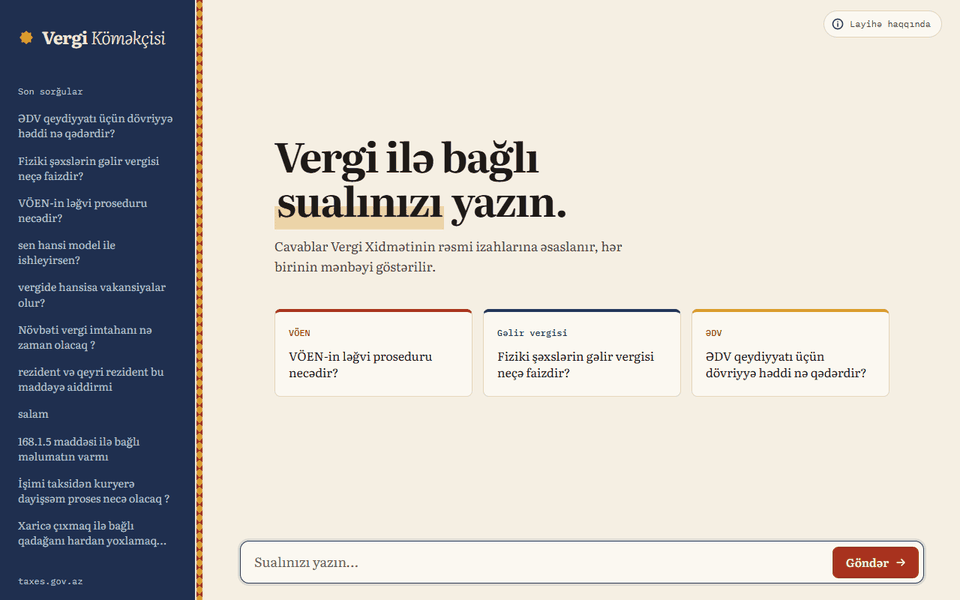
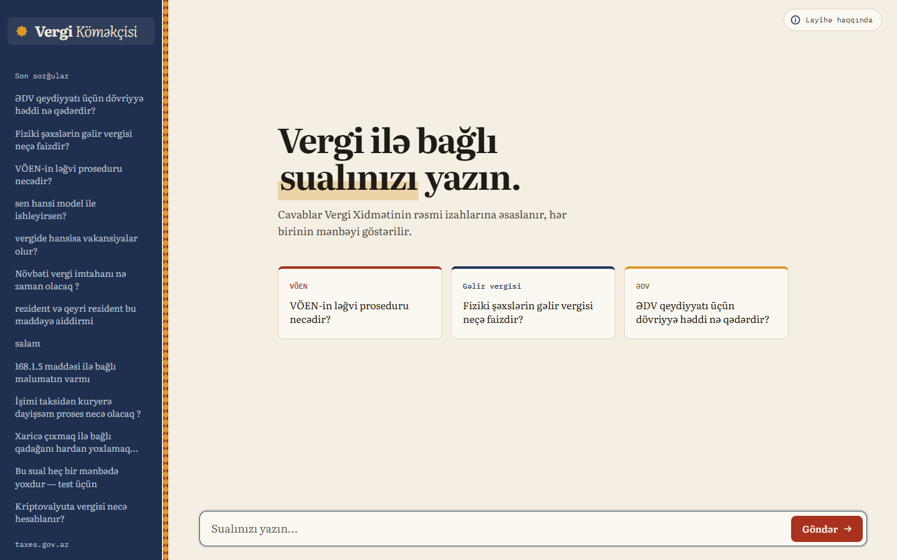
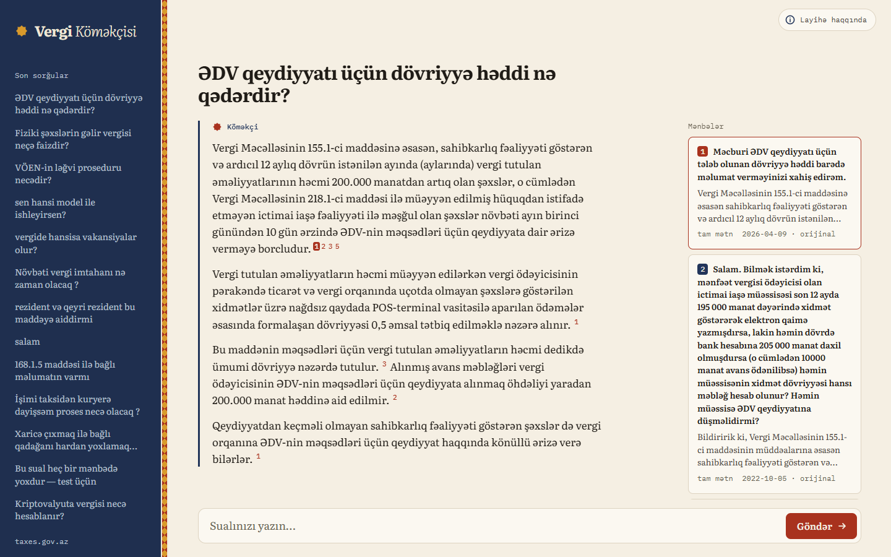
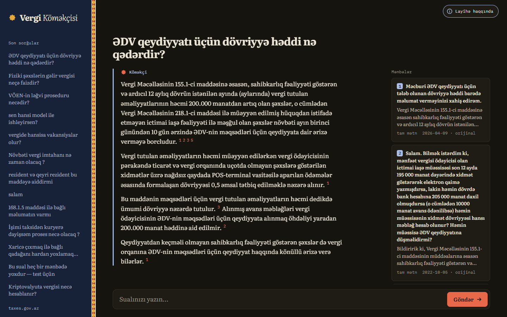
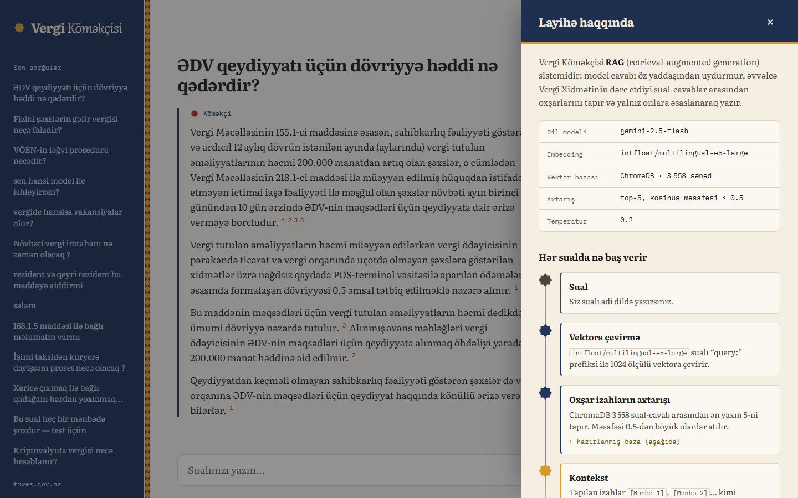
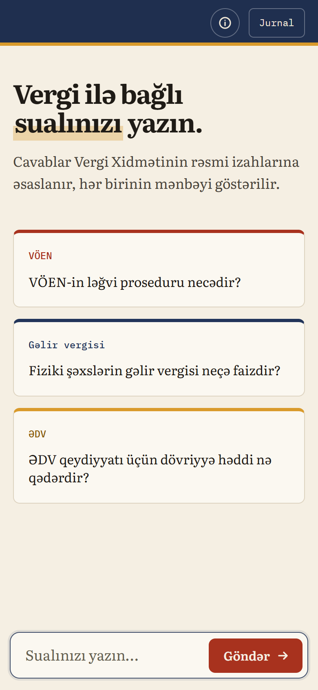
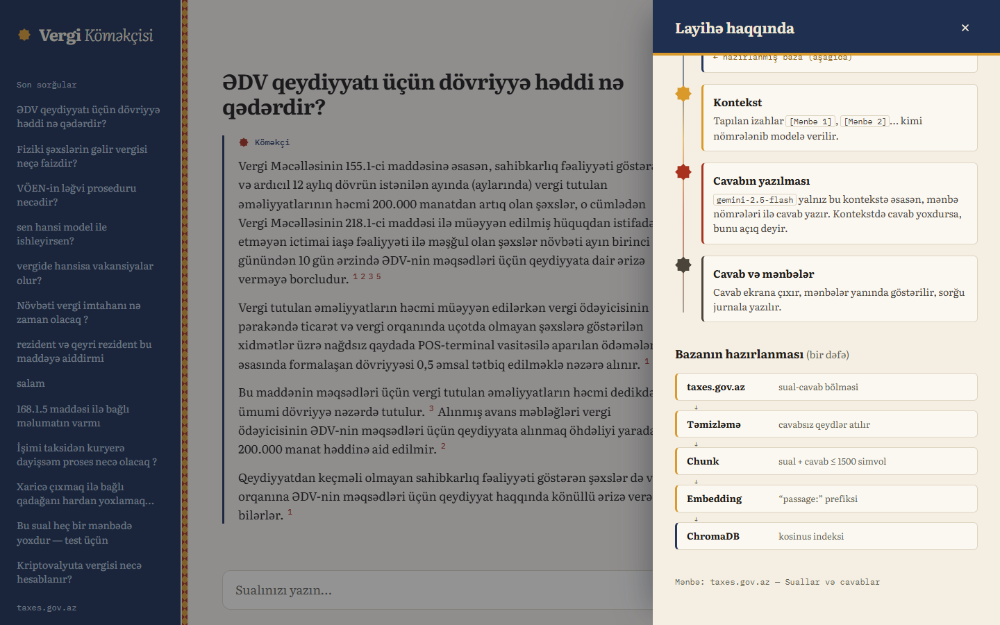

# Vergi Köməkçisi — tax Q&A assistant for Azerbaijan

A retrieval-augmented (RAG) chatbot that answers questions about Azerbaijani taxes
using the public question-and-answer archive of the State Tax Service
([taxes.gov.az → Suallar və cavablar](https://www.taxes.gov.az/az/page/suallar-ve-cavablar)).

The model does not answer from memory. For every question it first finds the most
similar official answers in the archive, then writes a reply based only on them and
cites each one as `[Mənbə N]`. If nothing relevant is found, it says so instead of
guessing.

> **Research purpose only.** This is not an official service of the State Tax Service,
> and its answers are not legal or tax advice. Always check the linked source.



<sub>Recorded from the running app with the real index and Gemini, no edits to the answer.</sub>

| Start screen | Answer with sources |
|---|---|
|  |  |
| **Dark theme** | **Project panel** |
|  |  |

<p align="center">
  
</p>

---

## How it works

```
                 ┌──────────────────── built once ────────────────────┐
 taxes.gov.az ─► scrape ─► clean ─► chunk ─► embed (RETRIEVAL_DOCUMENT) ─► ChromaDB
                                                                    │
                 ┌──────────────────── every question ──────────────┼─┐
 question ─► embed (RETRIEVAL_QUERY) ─► cosine search, top-5, threshold ◄┘ │
          ─► number hits as [Mənbə 1..n] ─► Gemini 2.5 Flash ─► answer + sources
                 └──────────────────────────────────────────────────────┘
```

| Stage | What happens | Where |
|---|---|---|
| Scrape | Pages of the Q&A section are fetched with `requests` + BeautifulSoup: asker name, e-mail, ID, question, answer, date, read count, rating. | `scripts/scraper.ipynb` |
| Clean | Records without an answer are dropped, text is trimmed, ID and metadata are parsed. 5,772 → 5,771 records. | `scripts/cleaning.ipynb` |
| Chunk | Each record becomes one chunk `Sual: … / Cavab: …` if question + answer ≤ 1,500 characters. 3,549 chunks. | `scripts/3_chunk_simple.py` |
| Embed + index | `gemini-embedding-001` through the Gemini API (768-dim, L2-normalised) → ChromaDB collection `taxes_az_qa` in `data/db/chroma_gemini`, HNSW with cosine distance. | `scripts/4g_embed_gemini.py` |
| Answer | Query embedded with task type `RETRIEVAL_QUERY` → top-5 → drop hits above the distance threshold → context → Gemini. | `app/main.py` |

The first version used `intfloat/multilingual-e5-large` run locally (`scripts/4_embed.py`,
`scripts/5_db.py`, index in `data/db/chroma`; the CLI `scripts/6_chatbot.py` still uses it).
It needs torch and about 3 GB of RAM, which no free host offers, so the web app switched to
API embeddings. `scripts/compare_embeddings.py` compares the two indexes; results are in
`data/eval/compare_report.md`:

| Index | hit@1 | hit@5 | MRR | Off-topic separation (top-1 distance) |
|---|---|---|---|---|
| e5 | 80% | 93% | 0.848 | on-topic ≤ 0.154 (p90), off-topic ≥ 0.185 |
| Gemini | 80% | 93% | 0.853 | on-topic ≤ 0.206 (p90), off-topic ≥ 0.373 |

Test set: 60 archive questions rewritten by Gemini as short user questions; a hit means
the original record was retrieved. Retrieval quality is the same, and Gemini separates
off-topic questions much more clearly, which lets the threshold reject them. With API
embeddings the app uses about 180 MB of RAM.

Generation settings: `gemini-2.5-flash`, temperature 0.2, max 1,024 output tokens,
thinking disabled. The system prompt (Azerbaijani) tells the model to answer only in
Azerbaijani, only from the context, to cite sources and to keep Tax Code references.

The web UI has the same diagram under **Layihə haqqında** (top right), filled with the
live settings from the server:

<p align="center">
  
</p>

---

## Quick start

The ChromaDB index is committed in `data/db/chroma_gemini`, so you can run the app without
rebuilding anything.

**Requirements:** Python 3.11 and a [Gemini API key](https://aistudio.google.com/apikey).
The web app alone needs only `requirements-app.txt` (no torch):

```bash
pip install -r requirements-app.txt
```

The steps below install the full environment, needed for the notebooks, the e5 index
and the CLI chatbot.

```bash
git clone https://github.com/Alihuseyn-Ismayilov/tax_rag.git
cd tax_rag
python -m venv venv
```

Activate the environment — Windows:

```bash
venv\Scripts\activate
```

macOS / Linux:

```bash
source venv/bin/activate
```

Install dependencies:

```bash
pip install -r requirements.txt
```

`requirements.txt` pins `torch==2.7.1+cu118` (CUDA 11.8). On a machine without an
NVIDIA GPU, install the CPU build first and then the rest:

```bash
pip install torch==2.7.1 torchvision==0.22.1 --index-url https://download.pytorch.org/whl/cpu
```

Create a `.env` file in the project root:

```
GEMINI_API_KEY=your_key_here
```

Run the web app. Paths in the code are relative (`../data/...`), so start it **from the
`app/` folder**:

```bash
cd app
uvicorn main:app --reload --port 8000
```

Open <http://localhost:8000>.

### Command-line chatbot

The same pipeline without the UI, on the older e5 index, from the `scripts/` folder:

```bash
cd scripts
python 6_chatbot.py
```

---

## Web app

FastAPI backend + a plain HTML/CSS/JS frontend (no build step).

- Ask a question, or click one of the topic cards on the start screen.
- Each answer shows numbered footnotes. Hover or focus a footnote to highlight its
  source in the right column; click it to jump there. Every source links to the
  original answer on taxes.gov.az.
- **Son sorğular** (left) lists recent questions from the query log. Click one to put
  it back in the input.
- Clicking the **Vergi Köməkçisi** logo returns to the start screen.
- **Layihə haqqında** opens a panel with the model settings and the pipeline diagram.
- Works on phones (the sidebar becomes a drawer), follows the system light/dark theme,
  is keyboard-accessible and respects reduced-motion settings.

### API

| Method | Path | Returns |
|---|---|---|
| `GET` | `/` | The chat page. |
| `POST` | `/ask` | Body `{"query": "..."}` → `answer`, `sources[]` (rank, similarity, question, answer, date, source URL…), `retrieval_ms`, `llm_ms`. |
| `GET` | `/history?n=20` | Last *n* entries of the query log, newest first. |
| `GET` | `/health` | Whether the embedding model, database and LLM client are loaded, plus document count. |
| `GET` | `/about` | Read-only settings for the info panel: models, embedding size, document count, top-k, threshold, temperature. No secrets. |

Example:

```bash
curl -X POST http://localhost:8000/ask -H "Content-Type: application/json" -d "{\"query\": \"ƏDV qeydiyyatı üçün dövriyyə həddi nə qədərdir?\"}"
```

Every `/ask` call is appended to `data/logs/query_log.jsonl` (query, source IDs,
distances, answer preview, timings).

---

## Rebuilding the index

Only needed if you re-scrape or change chunking or the embedding model. Run the steps
in order from the `scripts/` folder:

1. `scraper.ipynb` — scrape the Q&A pages. It writes to `../output/scraped/raw_data.csv`;
   move the file to `data/scraped/raw_data.csv` (the path the next step reads).
2. `cleaning.ipynb` — writes `data/processed/clean_data.csv`.
3. `python 3_chunk_simple.py` — writes `data/processed/chunks_simple.json`.
4. `python 4g_embed_gemini.py` — embeds the chunks through the Gemini API and builds
   `data/db/chroma_gemini` (the index the web app uses). The free tier allows 1,000
   embedded texts per day, so the 3,549 chunks take four daily runs; progress is cached
   in `data/processed/chunks_embedded_gemini.json`, and each run continues where the last
   one stopped. With billing enabled it finishes in minutes for well under $1.

   Older e5 index (CLI chatbot): `python 4_embed.py` (GPU recommended), then
   `python 5_db.py` → `data/db/chroma`.

If you change `EMBED_MODEL` or `EMBED_DIM`, change them in `4g_embed_gemini.py` and
`app/main.py` together; queries and documents must use the same model.

---

## Project layout

```
tax_rag/
├── app/
│   ├── main.py              FastAPI app: retrieval, generation, API routes
│   ├── templates/index.html chat page
│   └── static/              style.css, app.js
├── scripts/
│   ├── scraper.ipynb        1. scrape taxes.gov.az
│   ├── cleaning.ipynb       2. clean
│   ├── 3_chunk_simple.py    3. chunk
│   ├── 4g_embed_gemini.py   4. embed with Gemini + build the app's index
│   ├── 4_embed.py           4. (e5) embed (+ .ipynb version)
│   ├── 5_db.py              5. (e5) build ChromaDB (+ .ipynb version)
│   ├── 6_chatbot.py         CLI chatbot, e5 index (+ .ipynb version)
│   ├── compare_embeddings.py e5 vs Gemini retrieval comparison
│   └── analyze_chunks.ipynb chunk-length analysis
├── data/
│   ├── scraped/             raw scrape (csv, xlsx)
│   ├── processed/           clean data, chunks, embeddings
│   ├── db/chroma_gemini/    vector index used by the web app
│   ├── db/chroma/           older e5 index
│   ├── eval/                comparison test set and report
│   └── logs/                query log (/ask appends here)
├── Dockerfile, heroku.yml   deployment
├── requirements-app.txt     web app dependencies
├── requirements.txt         full environment
└── .env                     GEMINI_API_KEY (git-ignored)
```

---

## Settings

All in the config block at the top of `app/main.py`:

| Setting | Value | Meaning |
|---|---|---|
| `EMBED_MODEL` | `gemini-embedding-001` | Query embedding model; must match the one used for the index. |
| `EMBED_DIM` | 768 | Embedding size; must match the index. |
| `GEMINI_MODEL` | `gemini-2.5-flash` | Answer model. |
| `TOP_K` | 5 | Chunks retrieved per question. |
| `DISTANCE_THRESHOLD` | 0.30 | Cosine distance cut-off; weaker matches are dropped. Calibrated on the test set: matching sources come in at ≤ 0.29, off-topic questions at ≥ 0.33. |
| `TEMPERATURE` | 0.2 | Low, for factual answers. |
| `MAX_OUTPUT_TOKENS` | 1024 | Answer length limit. |
| `THINKING_BUDGET` | 0 | Gemini thinking mode off, for speed. |

---

## Limitations

- **Only short records are indexed.** 3,549 of 5,771 records fit the 1,500-character
  limit. The longer ~2,200 answers are not searchable yet; a paragraph-level chunker
  (`3_chunk_long.py`) is planned but not written.
- **Snapshot data.** The archive reflects the site on the scrape date. Tax rules change;
  older answers may be outdated even when they match well.
- **Answers are only as good as retrieval.** If the right answer is not among the top 5,
  the model will say it found nothing, or answer from a weaker match.
- **The source data contains askers' names and e-mail addresses** as published on
  taxes.gov.az. The app's Gemini index does not store them; the older e5 index does,
  but `/ask` never returns them.
- **Free-tier quota.** Every question uses one embedding request and one generation
  request; on the free Gemini tier the embedding quota is 1,000 per day.

---

## Deploy

The image (`Dockerfile`) holds only the app, `data/db/chroma_gemini` and
`requirements-app.txt`. It listens on `$PORT` and sets `SHOW_HISTORY=0`, so visitors do
not see each other's questions. `GEMINI_API_KEY` must be set in the host's environment.

### Heroku (container stack)

```bash
heroku login
heroku create <app-name> --stack container
heroku config:set GEMINI_API_KEY=<your key>
git push heroku main
```

`heroku.yml` tells Heroku to build the `Dockerfile`. The index must be committed, since
Heroku builds from the git repository.

### Any Docker host (e.g. an Azure VM)

```bash
docker build -t tax-rag .
docker run -d -p 80:8000 -e GEMINI_API_KEY=<your key> --restart unless-stopped tax-rag
```
